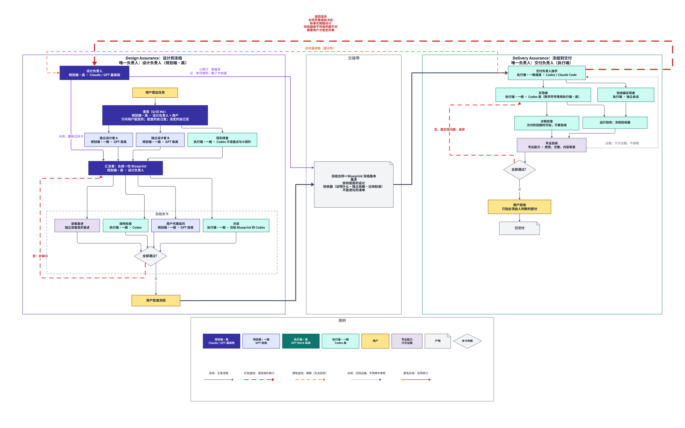

# Design Assurance 与 Delivery Assurance：合并流程草案（2026-11-09）

状态：草案，等用户看图确认。确认后再交给 GPT Pro / GPT Work 设计正式插件。

## 一句话

一件复杂任务从开始到交付只经过两个负责人：**设计阶段由 Design Assurance 负责，直到设计冻结；冻结后由 Delivery Assurance 负责，直到最终交付。** 其他一切都是它们调用的能力，不拥有任务。两个插件都有规划端和执行端，只是分工不同。

## 角色与端

| 档 | 谁可以担任 |
|---|---|
| 规划端·高 | Claude，或 GPT 最高档 |
| 规划端·一般 | GPT 极高 |
| 执行端·一般 | Codex 高（一般代码） |
| 执行端·高 | GPT Work 极高（数学符号、精细推导等） |

### Design Assurance 的角色

| 角色 | 端 | 做什么 |
|---|---|---|
| 设计负责人 | 规划端·高 | 整个设计阶段唯一负责人：决定每一步交给谁、何时进入下一步、何时冻结；冻结后审定一切合同修订 |
| 澄清（Grill Me） | 设计负责人主持，和用户进行 | 每个问题先分类：只有用户能定的才问；能查到的自己查；设计者该定的自己定并写理由。回答直接成为带出处的需求 |
| 独立设计者 ×2 | 规划端·一般或高（如 GPT Pro） | 各自独立出完整设计，互不参考 |
| 现实核查 | 执行端·一般（Codex） | 只读盘点代码与数据现实，跑小探针，核实技术可行性 |
| 汇总者 | 规划端·高（通常就是设计负责人） | 合成一份 Blueprint，保留被拒方案及理由 |
| 结构检查 | 执行端·一般（Codex 跑 Blueprint 检查器） | 结构、引用、证据、版本是否完整 |
| 用户代理追问 | 规划端·一般 | 扮演用户逐组件追问；答案不在 Blueprint 里就是缺口 |
| 冷读 | 执行端·一般（只给 Blueprint 的 Codex） | 列出开工前还要问的问题 |
| 读者复述 | 独立读者 | 走一遍的每一步能否被复述清楚 |
| 用户 | — | 回答澄清问题、在方案中选择、批准冻结 |

关卡里任何一项发现缺口，就回到汇总者补，直到全部通过才冻结。

### Delivery Assurance 的角色

| 角色 | 端 | 做什么 |
|---|---|---|
| 交付负责人 | 执行端·一般或高（Codex，或 Claude Code） | 冻结后唯一负责人：安排实现、验收、返修，决定“已交付”还是“退回设计” |
| 实现者 | 执行端·一般；涉及数学符号等用执行端·高 | 按冻结的 Blueprint 实现 |
| 验收器实现者 | 执行端，与实现者分开的会话 | 把冻结的验收器写成可运行的检查；不让实现者自己证明自己 |
| 专业验收 | 按需：视觉、文案、内容审查等专门能力，可在规划端 | 只交回证据，不接管任务 |
| 用户 | — | 只验收必须由人判断的部分，例如视觉品味 |

## 两阶段之间交什么

**冻结合同 = 冻结的 Blueprint 版本。** 包括：需求、拆到底层的设计、验收器（要证明什么、用什么独立依据判断、过线标准）、不能退化的清单、失败路径。

## 验收器：谁建、谁定

把“验收什么”和“怎样写成可运行的检查”分开：

1. **验收什么，由设计阶段定。** 冻结时写进 Blueprint，交付阶段只能实现，不能删、不能放宽、不能替换。
2. **怎样写成检查，由交付阶段做。** 测试代码、脚本、探针怎么写，交付负责人安排。
3. **诊断检查，交付阶段随时自由加。** 边做边发现需要的额外检查，直接加，不用请示。它们只帮助发现问题，不算验收，不能顶替冻结的验收器。
4. **新增或修改验收器：交付阶段有建议权，设计负责人有决定权。** 交付阶段发现“还应该验收某件事”或“某个验收器做不到、判据不对”，提交验收器提案；设计负责人审定。通过就生成 Blueprint 新版本，记一次改动并标明“本可想到”还是“跑了才知道”。

## 挡住降级实现（初步设想，待查证）

降级实现指：用替代品冒充真实实现（mock、占位、代理指标）、为了过检查而针对检查编写、悄悄缩小范围、改掉或绕过检查。交付阶段的五道防线：

1. **先写验收，后写实现。** 验收器实现者在独立会话里，只依据冻结合同把验收器写成可运行的检查，然后锁定（记录哈希）。实现者开工时检查已经存在。
2. **可见检查加隐藏用例。** 实现者能看到验收检查本身，但每个验收器另有一组实现者看不到的隐藏用例，由验收方保管，最后才运行，防止针对已知用例写代码。
3. **验收器必须先证明自己能抓坏东西。** 每个验收器要对一组已知错误版本（空输出、占位实现、代理替代、故意改坏的版本）报失败，否则验收器本身不合格。
4. **锁定与篡改检查。** 冻结的验收文件和用例被改动，一律视为合同修改请求，不能由交付阶段自己放行。
5. **独立裁判。** 最后判定由一个新的会话做：只拿冻结合同、产物和运行证据，不看实现者的过程叙述。实现者必须主动申报任何偏离合同的地方；没申报却被发现，直接判不通过。

交付阶段可以随时增加更严格的诊断检查和用例，但不能删、不能放宽冻结的验收；凡是改变“什么算完成”的，都交设计负责人决定。

## 退回：交付途中发现设计没想到的难点

交付负责人只在下列情况发**退回请求**，其余问题都在交付阶段内部返修：

- 合同本身矛盾或缺关键决定；
- 新事实推翻了设计；
- 验收器做不到、判据不对，或需要新增验收器；
- 需要只有用户能做的决定。

设计负责人收到后分两种处理：

- **小修订：** 只改受影响的节点，生成新版本，交回交付阶段继续。其余部分不停工。
- **大改：** 回到汇总与关卡，必要时重新澄清，重新冻结。

涉及只有用户能定的事，设计负责人再问用户；其余由设计负责人直接定并写理由。

## 衡量

- 冻结后用户还问了几个“本可想到”的问题；
- 交付阶段退回了几次，各属哪一类；
- 目标都接近零，但“跑了才知道”的退回不算失败。

## 待用户确认

1. 交付负责人放在执行端（Codex / Claude Code）是否合适。
2. 小修订是否由设计负责人单独决定，只有涉及用户才能定的事才问用户。
