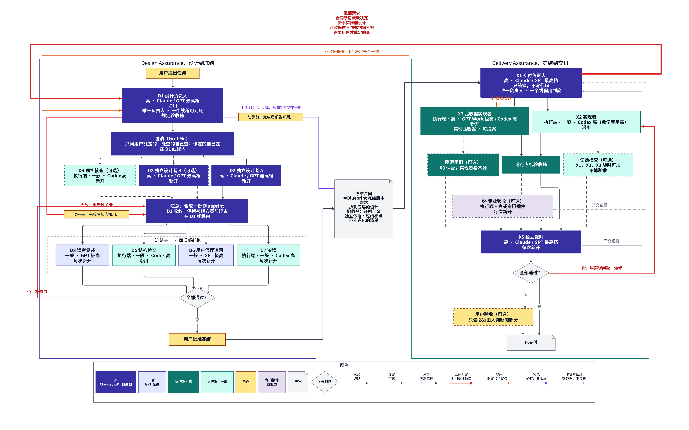

# Design Assurance 与 Delivery Assurance：合并流程草案 第二版（2026-11-09）

状态：用户已确认本版的角色、线程、必跑与可选、验收器归属与修订规则。第一版保留在 `ASSURANCE_PROCESS_DRAFT_20261109.md` 作对照。“挡住降级实现”一节等 GPT Pro 调研结果再定稿。

## 一句话

一件复杂任务只经过两个负责人：**设计阶段由 Design Assurance 的设计负责人 D1 负责，直到冻结；冻结后由 Delivery Assurance 的交付负责人 X1 负责，直到交付。** 每个负责人是一个线程，从头用到尾；其他角色都由它派出。最高决策人永远是用户。当前状态的权威是仓库里的状态文件：现在谁负责、Blueprint 第几版、哪些事未决定。D1 与 X1 都读写它。

D1 与 X1 是两个不同的线程，即使都由 Claude 担任：交付只能建议、设计才能决定，同一个线程无法自己制衡自己。

## 档次

| 档 | 谁可以担任 |
|---|---|
| 高 | Claude，或 GPT 最高档 |
| 一般 | GPT 极高 |
| 执行端·高 | GPT Work 极高（数学符号、精细推导等），或 Codex 高中较难的工作 |
| 执行端·一般 | Codex 高（一般代码） |

负责人只统筹，不亲自写代码。

## 角色、线程与是否必跑

线程规则：需要独立判断的角色**每次新开**，不能看到负责人的上下文；需要持续干活的角色**在本任务内沿用**。

### Design Assurance

| 编号 | 角色 | 档 | 线程 | 必跑 |
|---|---|---|---|---|
| D1 | 设计负责人：主持 Grill Me，汇总，规定验收器，审定一切修订 | 高 | 一个，沿用到冻结后仍负责修订 | 必跑 |
| — | 澄清（Grill Me）：只问只有用户能定的；能查的自己查；该定的自己定并写理由 | D1 主持，与用户进行 | 在 D1 线程内 | 必跑（需求已清楚时可很短） |
| D2 | 独立设计者 A：交出完整 Blueprint | 高 | 新开 | 必跑 |
| D3 | 独立设计者 B：交出完整 Blueprint | 高 | 新开 | 可选：复杂或高风险时 |
| D4 | 现实核查：只读盘点代码与数据，跑小探针 | 执行端·一般 | 新开，设计阶段内沿用 | 可选：已有代码或数据时 |
| — | 汇总：D1 对比各份 Blueprint，收敛成一份，保留被拒方案与理由 | D1 | 在 D1 线程内 | 必跑 |
| D5 | 结构检查：跑 Blueprint 检查器 | 执行端·一般 | 可沿用 D4 | 必跑 |
| D6 | 用户代理追问：扮演用户逐组件追问，答案不在 Blueprint 里即为缺口 | 一般 | 每次新开 | 可选：面向用户的系统 |
| D7 | 冷读：只给 Blueprint，列出开工前还要问的问题 | 执行端·一般 | 每次新开 | 必跑 |
| D8 | 读者复述：每一步交给新读者复述，复述不对就重写 | 一般 | 每一步新开 | 可选：走一遍要给人读时 |
| — | 用户批准冻结 | 用户 | — | 必跑 |

大系统可以先按块分给多个设计者（例如骨架、两个难点子树），每块是否需要 D2、D3 双份由 D1 决定。

### Delivery Assurance

| 编号 | 角色 | 档 | 线程 | 必跑 |
|---|---|---|---|---|
| X1 | 交付负责人：只统筹不写代码，汇总验收提案，决定交付或退回 | 高 | 一个，沿用到交付 | 必跑 |
| X2 | 实现者 | 执行端·一般；数学符号等用执行端·高 | 本任务内沿用 | 必跑 |
| X3 | 验收器实现者：把冻结的验收器写成检查，并配已知坏样本证明它能抓到问题 | 执行端·高 | 新开，与 X2 分开，之后沿用 | 必跑 |
| — | 运行冻结验收器 | X3 | — | 必跑 |
| — | 诊断检查：更严、不算验收 | X1、X2、X3 都可随时加 | — | 可选 |
| — | 隐藏用例：实现者看不到，最后才跑 | X3 保管 | — | 可选：能做到时 |
| X4 | 专业验收：视觉、文案、内容，只交回证据 | 执行端·高或专门插件 | 每次新开 | 可选：交付物有这些质量要求时 |
| X5 | 独立裁判：只拿合同、产物与运行证据判定 | 高 | 每次判定新开 | 必跑 |
| — | 用户验收：只验必须由人判断的部分 | 用户 | — | 可选 |

## 验收器：谁规定、谁实现、谁建议、谁决定

| 动作 | 谁 |
|---|---|
| 规定：证明什么、独立依据、过线标准 | D1，写进 Blueprint 并冻结 |
| 实现：写成检查并配已知坏样本 | X3 |
| 加诊断检查（更严、不算验收） | X1、X2、X3 随时可加 |
| 建议新增或修改验收器 | X3 主要提出，X1 汇总后提交 |
| 决定是否采纳 | D1 |

冻结的验收器，交付阶段不能删、不能放宽、不能替换。

## 修订：小修订与大改

### 怎样区分

**小修订**同时满足：只影响少数几个节点；不改需求；不改其他组件的接口；不涉及只有用户能定的事。例子：

- 冻结的验收器要求某误差小于 1e-6，但参考依据本身只准到 1e-5，验收器做不到；改为 1e-5 并写理由。
- 合同前后矛盾：一处写输出列顺序 A、B、C，下游按 B、A 读取；定一种。
- 指定的库版本没有需要的函数；换成有证据支持的另一版本。
- 用户临时提的小改动，例如报告多加一列，不影响其他组件。

**大改**：改需求、改跨组件接口，或需要用户拍板。退回汇总，重新过关卡。

不确定属于哪一种时，按大改处理。精确规则待正式插件设计时细化。

### 用户必须知情

**任何修订都不能在用户不知道的情况下发生，小修订也一样。**

- **动手前：** D1 告诉用户要改什么、为什么、属于小修订还是大改、影响哪些节点。
  - D1 由 GPT 担任时：D1 只写出修订提示词交给用户，由用户去跑，不自己跑。
  - D1 由 Claude 担任时：跑之前先告诉用户要跑什么。
- **完成后：** 告诉用户实际改了什么：Blueprint 新旧版本差异、原因、标注“本可想到”还是“跑了才知道”。
- 小修订只重跑结构检查，不重走整套关卡；受影响的部分暂停，其余不停工。

## 退回

X1 只在下列情况发退回请求，其余问题在交付阶段内部返修：合同矛盾或缺决定；新事实推翻设计；验收器做不到或判据不对，或需要新增验收器；需要只有用户能定的事。D1 收到后按上节判断小修订或大改。

## 挡住降级实现（待 GPT Pro 调研定稿）

初步设想五道防线：先写验收后写实现；可见检查加隐藏用例；验收器先证明能抓坏东西；锁定与篡改检查；独立裁判与偏离申报。详见第一版草案对应一节。

## 衡量

- 冻结后用户还问了几个“本可想到”的问题；
- 退回次数及类别；
- 修订是否都在事前事后告知用户。
