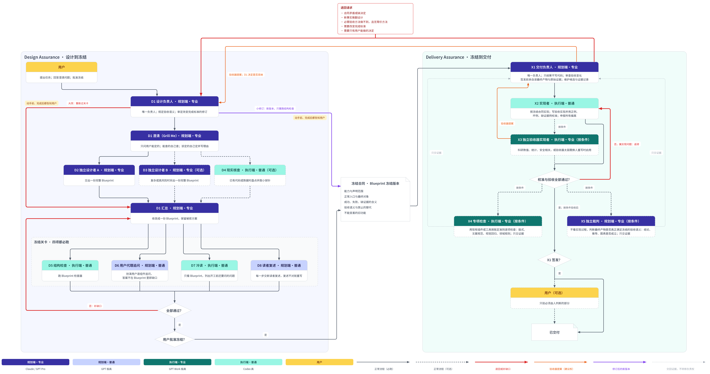

# Design Assurance 与 Delivery Assurance：流程 0.1（2026-11-10）

状态：**用户认可，作为 0.1。** 后续发现问题按 0.2、0.3 迭代。本文件取代第一、二版草案（保留作对照），并吸收 GPT Pro 反降级调研（`YuukiAS/AI_Research_Toolkit`，分支 `research/delivery-anti-degradation-20261109`，`docs/research/delivery-anti-degradation-20261109/REPORT.md`）。

## 1. 一句话

一件复杂任务只经过两个负责人：**设计阶段由设计负责人 D1 负责，直到冻结；冻结后由交付负责人 X1 负责，直到交付。** 每个负责人是一个线程，用到底；其他角色都由它派出，只交产物或证据，不拥有任务。最高决策人是用户。当前状态的唯一权威是仓库里的状态文件。

D1 与 X1 是两个不同线程，即使都由 Claude 担任：交付只能建议、设计才能决定完成标准，同一线程无法自我制衡。负责人只统筹，不亲自写代码。

## 2. 档次

规划端负责判断与统筹，执行端负责动手实现与运行检查。X4 是执行端，因为它按既定准则跑检查；X5 是规划端，因为它做的是开放的专业判断。

| 档 | 谁可以担任 |
|---|---|
| 规划端·专业 | Claude，或 GPT Pro |
| 规划端·普通 | GPT 极高 |
| 执行端·专业 | GPT Work 极高（数学符号、精细推导等） |
| 执行端·普通 | Codex 高（一般代码） |

## 3. 角色

线程规则：需要独立判断的角色每次新开，不看负责人的上下文；需要持续干活的角色在本任务内沿用。

### Design Assurance

| 编号 | 角色 | 档 | 必跑 | 负责 |
|---|---|---|---|---|
| D1 | 设计负责人 | 规划端·专业 | 必跑 | 唯一负责人；主持澄清（Grill Me）；汇总；规定验收语义；审定所有改变完成标准的修订 |
| D2 | 独立设计者 A | 规划端·专业 | 必跑 | 交出一份完整 Blueprint |
| D3 | 独立设计者 B | 规划端·专业 | 可选 | 复杂或高风险时另出一份完整 Blueprint |
| D4 | 现实核查 | 执行端·普通 | 可选 | 已有代码或数据时盘点并跑小探针 |
| D5 | 结构检查 | 执行端·普通 | 必跑 | 跑 Blueprint 检查器 |
| D6 | 用户代理追问 | 规划端·普通 | 必跑 | 扮演用户逐组件追问，答案不在 Blueprint 里即缺口 |
| D7 | 冷读 | 执行端·普通 | 必跑 | 只看 Blueprint，列出开工前还要问的问题 |
| D8 | 读者复述 | 规划端·普通 | 必跑 | 每一步交新读者复述，复述不对就重写 |

**2026-11-11 修订说明（D8 派发与用户转交）：** 按 [D1 规格第 2.1a 节](plugin-0.1-d1/SPEC.md)，需要用户手动转交的规划端角色每角色每轮最多转交一条提示词；执行端 Codex 由负责人直接派发，次数不限且不占用户转交次数。负责人能自动派发时，一次性批量派发，每个单位各起全新线程、只得本单位材料；只能用户转交时，整轮合成一条提示词交一个新线程，随机打乱单位顺序，逐个只依据本单位文字作答，并记录 `reader_isolation: "single-thread-batch"`，由 D1 考虑独立性降低，关键单位可下一轮自动补做独立复述。D8 默认规划端·普通 GPT 极高，负责人可自动派发时允许改用执行端最高推理档；“每一步每一轮换新读者”的原要求保留，由负责人批量完成或如实登记单线程合批的隔离降低，不再要求用户逐条转交。

**2026-11-12 修订说明（用户最终决定，取代前段相关规定）：** 按 [D1 规格第 2.1a 节](plugin-0.1-d1/SPEC.md)，需要用户手动转交的规划端角色（D2、D3、D6、D8、X5）在 GPT 网页端运行，每个角色每轮只转交一次；D8 每轮用一个新 GPT 对话合批处理本轮全部单位，随机逐个只依据自身文字作答，记录 `reader_isolation: "single-thread-batch"`，由 D1 逐单位判断，读错的单位改写后在下一轮新对话重读改动及受影响相邻单位。负责人 D1、X1 仍按原流程，由 Claude 或 GPT Pro 担任，各自使用长期线程；规划 `SKILL.md` 由 Claude Code 和 GPT Work 读取。Claude 担任负责人时直接派发执行端，GPT 担任时生成完整提示词交用户转交给 Codex，设计阶段由 D1、交付阶段由 X1 负责。本段取代上一段修订说明中关于自动批量新开读者线程、执行端代跑 D8、关键单位独立复述及每步更换读者的规定；合批全部正确就是 D8 有效通过，冻结说明如实写明合批方式。

澄清（Grill Me）每个问题先分类：只有用户能定的才问用户；能查到的自己查；设计者该定的自己定并写理由。用户的回答成为带出处的需求。

冻结关卡 D5–D8 全部通过、用户批准后才冻结，才适合交给交付端。

### Delivery Assurance

| 编号 | 角色 | 档 | 必跑 | 负责 |
|---|---|---|---|---|
| X1 | 交付负责人 | 规划端·专业 | 必跑 | 唯一负责人；只统筹不写代码；审查所有验收资产变化；维护候选与证据记录；**签发前必须亲自读最终产物与原始证据，不看实现者摘要**；唯一决定交付或退回 |
| X2 | 实现者 | 执行端·普通；数学符号等用执行端·专业 | 必跑 | 按冻结合同实现；默认也负责写验收实现，并用正例、坏例、缺证据例校准；主动申报所有偏离 |
| X3 | 独立验收器实现者 | 执行端·专业 | 按条件 | **必须启用：** 科研数值或统计、安全相关的验收；或校准发现某验收器太弱，需换人重写 |
| X4 | 专项检查 | 执行端·专业或专门插件 | 按条件 | 用现有专门插件或工具，按既定准则逐项检查某一维度（版式、文案规范、视觉回归、领域规则）。交付物有这类维度且有现成检查能力时启用；只交证据 |
| X5 | 独立裁判 | 规划端·专业 | 按条件 | 不看实现过程，独立判断最终产物是否真正满足冻结的验收语义：结论是否成立、推导是否正确、图表是否误导。**必须启用：** 这类判断无法由准则和机械检查给出时。只交证据，签发仍归 X1 |
| — | 用户 | — | 可选 | 只验必须由人判断的部分 |

## 4. 冻结合同

冻结合同 = Blueprint 冻结版本，必须能回答：

1. 要交付的能力与允许声明的范围；
2. 正常入口与最终消费对象；
3. 成功、失败、缺证据（无法判断）的可观察含义；
4. 必需证据的类型与真实度，以及不可替换的方法；
5. 禁止的替代：mock、代理指标、缩小范围、低配实现；
6. 不能变差的旧功能与代表性回归；
7. 关键正例、危险坏例、缺证据例；
8. 哪些变化交付端可自行处理，哪些必须退回设计；
9. 权限、数据、费用、账号、设备边界。

D1 冻结的是**验收语义**（证明什么、什么算成功），以及决定语义的不可替换方法；不冻结每个测试脚本。

## 5. 验收器修改分级

| 变化 | 例子 | 谁决定 |
|---|---|---|
| 加诊断 | 日志、截图、探针 | 交付端 |
| 机械修复 | 路径、选择器、版本、解析错误、结果不稳定 | 交付端；修完用正例、坏例、缺证据例重新校准 |
| 等价方法替换 | 同等真实度的新运行器 | 交付端；须证明观察对象、阈值、覆盖、证据真实度不变 |
| 更严的补充检查 | 加坏例、加回归，不缩小合法实现空间 | 交付端 |
| 改变“什么算完成” | 阈值、范围、总体、入口、证据真实度、允许替代、旧功能承诺 | **D1**，形成新冻结版本 |

交付端的修改由 X1 记录，汇报时一并告诉用户。

## 6. 挡住降级实现

必须做的：

1. 冻结合同写明禁止的替代与不能变差的旧功能；
2. **候选与证据记录**：当前提交或源码集合、最终构建/安装/部署对象、运行器与环境、观察时间、原始证据路径、声明范围，防止验 A 交 B；
3. 优先用项目已有的真实运行器；
4. 每个关键验收器至少一个正例、一个坏例、一个缺证据例，必须分别通过、失败、判无法判断；
5. 从正常入口验最终成品，同时验旧功能；
6. 实现者主动申报所有偏离、替代、未运行项与证据缺口。

不默认做的：

- 隐藏用例只有在真实读取权限隔离（私有验证仓库、受保护环境等）时才启用，并且才可以这样称呼；新开线程、独立工作树都不算隐藏；
- 独立模型裁判按第 3 节条件启用；
- 中央服务、数据库、常驻监控、通用验收平台。

## 7. 修订与退回

**小修订**同时满足：只影响少数节点；不改需求；不改跨组件接口；不涉及只有用户能定的事。D1 改后只重跑结构检查，受影响部分暂停，其余不停工。**大改**：改需求、跨组件接口或需要用户拍板，退回汇总并重新过关卡。不确定时按大改处理。

**用户必须知情：**

- 动手前：D1 说明改什么、为什么、属于哪类、影响哪些节点。D1 由 GPT 担任时，只写出提示词交给用户去跑；由 Claude 担任时，先告诉用户要跑什么。
- 完成后：给出 Blueprint 新旧版本差异、原因，并标注“本可想到”或“跑了才知道”。

X1 只在下列情况退回设计，其余问题都在交付端内部返修：

- 合同矛盾或缺决定；
- 新事实推翻设计；
- 必需的验收方法做不到，且没有等价方法；
- 需要改变完成标准；
- 需要只有用户能做的决定。

## 8. 衡量

- 冻结后用户还问了几个“本可想到”的问题；
- 退回次数及类别；
- 修订是否都事前事后告知用户。

## 9. 插件要包含什么（0.1）

| 部分 | 做什么 | 属于 |
|---|---|---|
| 状态文件 | 唯一权威：阶段、负责人、Blueprint 版本、待用户决定的事、修订记录、派发记录 | 共用 |
| 调度 | 读状态与本流程，告诉用户下一步发给谁（角色、档次、新开或沿用线程），给出可直接复制的提示词；Claude 自己执行的步骤先告诉用户 | 共用 |
| 角色卡 | 每个角色一张：任务、能读什么、不能读什么、产出写到哪、怎样算完成、回复格式；派发的提示词 = 角色卡 + 本次材料 | 共用 |
| 提示词规则 | 自包含：仓库、分支、写入测试、先读什么、写回哪里、回复格式 | 共用 |
| 修订与告知 | 小修订与大改判别；事前事后告知模板，附版本差异 | 共用 |
| 衡量 | 第 8 节的记录 | 共用 |
| 澄清（Grill Me）规则 | 问题分类与提问方式 | Design |
| 冻结关卡 | D5–D8 各自通过标准，接 Blueprint 检查器，未过退回哪里 | Design |
| 冻结合同格式 | 在 Blueprint 上增加第 4 节内容 | Design |
| 验收器规则 | 第 5 节分级、校准要求、X3/X5 启用条件 | Delivery |
| 证据与签发 | 候选与证据记录格式、偏离申报模板、X1 签发清单 | Delivery |

## 10. 打包

- AI_Skills_Collection 做出的插件要能直接给 Claude、GPT Work、Codex 用：
  - 规划端规则写成一份 `SKILL.md`，Claude Code 与 GPT Work 直接读取；
  - 执行端做成 Codex 插件。
- ChatGPT 网页端（GPT Pro、GPT 极高）需用 OpenAI 自己的插件打包工具另外打包，到打包阶段再处理。

## 11. 怎样把插件做出来

按本流程自己做一遍：

1. D1 由 Claude 担任；
2. D2、D3 由两份 GPT Pro 各自独立出插件规格，有疑问写成问题清单交回；
3. D1 汇总，过冻结关卡，用户批准冻结；
4. X1 由 Claude 担任，Codex 在 AI_Skills_Collection 实现，遵守该仓库的维护规则（workflow-core 与 ai-skills-core）。

一个私有统计研究项目的三份 Blueprint 是这套流程的第一次真实试跑，用来检验插件规格有没有漏掉试跑暴露的问题。
